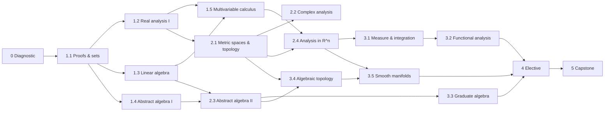

# Roadmap

Weeks are about 6 hours of study each. "Cumulative" is the week number at which the module ends if you do everything in order with no skimming.

## Timeline

| Phase | Module | Weeks | Cumulative |
|---|---|---|---|
| 0 | Diagnostic test and study set-up | 2 | 2 |
| 1 | 1.1 Proofs, logic and sets | 6 | 8 |
| 1 | 1.2 Real analysis I | 12 | 20 |
| 1 | 1.3 Linear algebra | 10 | 30 |
| 1 | 1.4 Abstract algebra I | 10 | 40 |
| 1 | 1.5 Multivariable calculus | 6 | 46 |
| 2 | 2.1 Metric spaces and topology | 8 | 54 |
| 2 | 2.2 Complex analysis | 10 | 64 |
| 2 | 2.3 Abstract algebra II (fields, Galois, modules) | 12 | 76 |
| 2 | 2.4 Analysis in $\mathbb{R}^n$ | 10 | 86 |
| 3 | 3.1 Measure and integration | 14 | 100 |
| 3 | 3.3 Graduate algebra | 14 | 114 |
| 3 | 3.2 Functional analysis | 12 | 126 |
| 3 | 3.4 Algebraic topology | 14 | 140 |
| 3 | 3.5 Smooth manifolds | 14 | 154 |
| 4 | Elective | 16 | 170 |
| 5 | Capstone dissertation | 16 | 186 |

Phase 3 order follows the recommendation in [03-masters-core/README.md](03-masters-core/README.md).

## Two ways to schedule

- **Sequential (default):** one module at a time. Simplest to keep going with limited hours.
- **Interleaved:** run an analysis track and an algebra track at the same time, for example 4 hours on one and 2 on the other. Each phase README describes a two-track option. This keeps the total about the same but gives variety and more time for ideas to settle.

## Checkpoints

| When | Checkpoint |
|---|---|
| End of Phase 1 | Phase exit test in [01-refresher/README.md](01-refresher/README.md) |
| End of Phase 2 | Timed qualifying-style paper in [02-bridge/README.md](02-bridge/README.md) |
| End of Phase 3 | Mock qualifying exam (two 3-hour papers) in [03-masters-core/README.md](03-masters-core/README.md) |
| End of Phase 5 | Finished dissertation, reviewed by someone outside the course |

## Rest and review

Plan about 6 weeks a year with no new material. Use them for review, catching up, or a break. The 46-weeks-a-year figure in the main README already allows for this.
